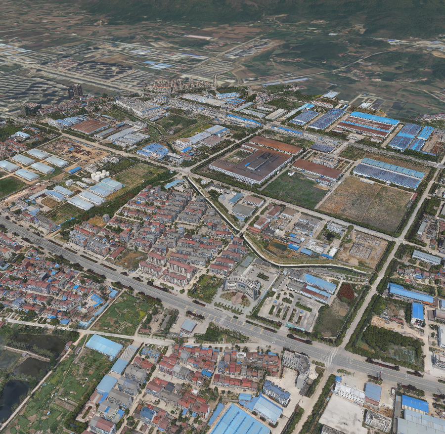

<div align="center">

# Digital Earth

**A DeepSeek Harness panel for 3D Tiles and 3DGS layers on a CesiumJS globe, built to work alongside an Agent conversation**

[中文](README.md) · [English](README.en.md)


</div>



Digital Earth adds a CesiumJS globe to DSH. It opens beside the conversation so photogrammetry and Gaussian-splatting deliverables can be explored while you chat, and it lets the Agent read and drive the scene in natural language. CesiumJS 1.147 is self-hosted: no Cesium ion token, no external static assets.

## Features

| Capability | Details |
| --- | --- |
| Beside the chat | A session-scoped “Digital Earth” tab in the right sidebar sits next to the conversation; the globe button in the chat header opens it, and a full-screen immersive mode is one click away |
| Agent integration | Built-in `earth_scene` and `earth_capture` tools: inspect the scene, load layers, switch basemap / terrain, fly to coordinates, pick properties and capture snapshots — all from natural language |
| 3D Tiles & 3DGS | Recursive `tileset.json` discovery from a local folder; 3D Tiles 1.0 / 1.1 (b3dm, glb) and 3DGS (`KHR_gaussian_splatting`, SPZ included); multiple layers with show / hide, fly-to and remove |
| Online & local paths | Paste an `http(s)` URL or an absolute local path; cross-origin failures fall back to the host proxy automatically |
| Basemaps | Built-in Esri presets plus custom XYZ (TMS, projection, subdomains, max level) / WMS / ArcGIS services; the no-basemap mode stays fully usable |
| Terrain | ArcGIS WorldElevation3D built in; any Cesium or ArcGIS terrain service can be added |
| Local tiles | Point at a local XYZ / TMS tile folder and use it as a basemap offline |
| Source management | Add, edit, delete, select and restore defaults in the settings panel; persisted to `$DSH_HOME/digital-earth/sources.json` |
| Cursor HUD | Longitude / latitude plus elevation on the bare globe, terrain and 3D surfaces; ~8 Hz sampling without React re-renders |
| Measurement | Distance, area, height difference, 3D Tiles property picking, snapshot, reset view |
| Layer statistics | Tiles, pending tiles, triangles and cache per layer; global FPS and camera height / heading |
| Bilingual | Follows the DSH language and switches between Chinese and English at runtime |
| Theme | Follows DSH or the system; explicit light / dark override scoped to this panel |

## Requirements

- DeepSeek Harness `>=0.2.1-rc.1 <0.3.0-0`
- A modern browser with WebGL / WebGL2
- Network access to the public ArcGIS services (`server.arcgisonline.com`, `elevation3d.arcgis.com`)

## Install

Search for “Digital Earth” in the plugin market, or use the CLI:

```bash
# from the npm registry
dsh plugin --profile <profile> add @cveo/dsh-digital-earth

# from a local folder or tarball
dsh plugin --profile <profile> add "<path-to-plugin>"
dsh plugin --profile <profile> add "./cveo-dsh-digital-earth-1.1.0.tgz"
```

Fully quit and reopen DSH after installing or updating: client bundles are registered when the host starts, so reloading the page alone is not enough. The “Digital Earth” entry then appears in the sidebar, and a globe button appears in the conversation header.

## Usage

| Entry | What it does |
| --- | --- |
| **Globe button in the chat header** | Opens the Digital Earth tab beside the conversation; “Full screen” expands it |
| **Data ▾** | Open a local folder (`tileset.json` discovery), load an online URL or local path, clear measurements and picking results |
| **Basemap ▾ / Terrain ▾** | Switch between configured sources, or turn basemap / terrain off |
| **Measure ▾** | Distance, area, height, property picking; left click to add a point, double click to finish |
| **Layers n** | Layer list: click a name to fly to it, ◉ toggles visibility, ✕ removes it |
| **Appearance** | Follow system / light / dark |
| **Settings** | Source management (imagery / terrain), appearance, the snapshot annotation switch and an About tab |

Cursor coordinates are sampled at roughly 8 Hz: a ray–ellipsoid intersection keeps the readout alive on the bare globe, the depth buffer provides 3D Tiles / 3DGS surface elevations, and `globe.getHeight` corrects terrain. HUD text is written straight to the DOM, so it never triggers React re-renders.

## Working with the Agent

Once the globe tab is open, the plugin connects the panel to the current conversation through an SSE command bridge, so the model can read and change the scene in natural language. Two tools are exposed to the Agent:

| Tool | Parameters | What it does |
| --- | --- | --- |
| `earth_scene` | `action` (`status` / `list` / `load` / `remove` / `visible` / `basemap` / `terrain` / `fly` / `reset` / `pick`) | Read scene state and layer statistics; load / remove / show or hide layers; switch basemap and terrain; fly to coordinates; pick whatever sits at the view centre |
| `earth_capture` | `width`, `format`, `include_hud`, `label` | Capture a snapshot and return its absolute host path; by default the image keeps only the clean 3D view, and `include_hud=true` burns the coordinate HUD and team credit into the picture |

- **Snapshot annotations**: the panel toolbar and HUD are DOM chrome, so they can never be exported with the WebGL canvas. Turning on **Settings → Overlay coordinate HUD and credits in snapshots** redraws the cursor coordinates, camera parameters and team credit onto the image canvas; it applies to manual and Agent captures alike and is off by default.
- **Local data**: the Agent can only load folders the user opened once through the panel’s **Data → Open local folder**. The host validates this whitelist before dispatching a command and returns an actionable error otherwise. Neither the command bridge nor any tool result exposes the plugin token to the model, so the model cannot widen the whitelist itself.
- **Snapshots and multimodal models**: captures are written to `$DSH_HOME/digital-earth/captures`. Models that understand images can call `read_image` on the returned path; models without vision fall back to the `status` JSON from `earth_scene` instead of guessing the picture.
- **Try saying**: “Open Digital Earth, switch to satellite imagery, fly to Wuhan University and take a snapshot”; “Load the tileset from the folder I just picked”; “Hide the second layer and report the camera height”.

## Data sources

All built-in presets are token-free ArcGIS public services and can be enabled in one click from the settings panel:

| Kind | Presets |
| --- | --- |
| Imagery | Esri World Imagery, World Topographic, World Street Map, Light Gray Canvas, World Shaded Relief, World Ocean, World Hillshade |
| Terrain | ArcGIS WorldElevation3D |

Custom sources support:

- **XYZ tiles** — `{z}/{x}/{y}` templates, TMS (south-origin Y), Web Mercator / geographic projection, subdomains, maximum level, attribution
- **WMS** — service URL plus layer names
- **ArcGIS** — MapServer URL (level metadata is read automatically)
- **Cesium terrain** — terrain service URL with optional vertex normals / water mask
- **Local tile folders** — pick a folder right from the XYZ form; the host exposes it through its directory whitelist

Selections persist with the rest of the catalog, so changing ports or restarting DSH never loses them.

## How it works

- **Host** (`index.js`) registers the `/api/3dviewer/*` routes: Cesium static assets, local folder scanning and whitelisting, tile serving, the cross-origin proxy, catalog persistence, plus the `earth_scene` / `earth_capture` tools and the session command bridge.
- **Client** (`client.js`) loads as a DSH client module, claims the `sidebar.panellist`, `main` and right-sidebar tab slots, and dynamically imports the self-hosted CesiumJS build. The tab panel uses `EventSource` to receive Agent commands, executes them in order and posts an acknowledgement.
- **Agent bridge**: `GET /api/3dviewer/bridge?session=…` pushes commands, `POST /api/3dviewer/bridge` acknowledges them; within one session only the most recently opened globe tab executes commands, so nothing loads twice. Snapshots are written by `POST /api/3dviewer/capture` and read back through `/api/3dviewer/files`.
- **Security**: every route is bound to the DSH `connection` session and same-origin checks with a plugin-instance token that is only handed to the page and never appears in tool results; `/tiles` only serves directories opened through the file picker, and Agent-side local loads obey the same whitelist with a real-path check; the whitelist registration endpoint `/scan` accepts only the panel’s own request header, so a model cannot trigger it through a same-origin Cesium fetch; the `/remote` proxy rejects literal loopback and private addresses plus 3xx redirects to prevent direct SSRF; it does not resolve DNS, so a hostname that resolves to an internal address can still slip through (see Known limitations). The plugin never uploads data or reaches out on its own.
- **Self-hosted CesiumJS**: `vendor/cesium` ships with the plugin — no CDN, no Cesium ion token.

## Known limitations

- When the same session opens the globe tab in several browser tabs, only the most recently connected one executes Agent commands; the others stay read-only.
- Agent captures require the globe tab to be visible: switching to another tab or backgrounding the window returns a clear “panel is not visible” error instead of a blank image.
- The capture folder keeps only the latest 50 images so it cannot grow without bound.
- The `/remote` proxy does not forward query strings yet, so WMS / WMTS requires a service that allows direct cross-origin requests; proxy query support is planned.
- The `/remote` proxy classifies internal addresses literally and does not resolve DNS; do not expose it to an untrusted model/user mix on untrusted networks. DNS resolution plus post-resolve checks are planned.
- Public Esri services can be unreachable on some networks; the basemap then renders empty, and a local tile source can be used instead.

## Layout

```text
dsh-digital-earth/
├── index.js            # host plugin: routes, proxy, local assets, persistence, Agent tools and bridge
├── client.js           # client panel: Cesium scene, toolbar, source settings, chat-side tab and bridge
├── cordis.patch.yml    # bundle patch
├── locale/             # plugin market metadata (zh / en)
├── vendor/cesium/      # self-hosted CesiumJS 1.147
├── icon.svg
└── preview.png
```

## Feedback

Issues and suggestions are welcome in the [issue tracker](https://github.com/CVEO/dsh-digital-earth/issues). Please make sure `node --check index.js && node --check client.js` passes before opening a pull request.

## Team

Maintained by the **CVEO Research Group, Wuhan University** · <https://www.whu-cveo.com/>

## License

MIT. CesiumJS is distributed under Apache-2.0; see [`NOTICE`](NOTICE) for third-party attribution.
