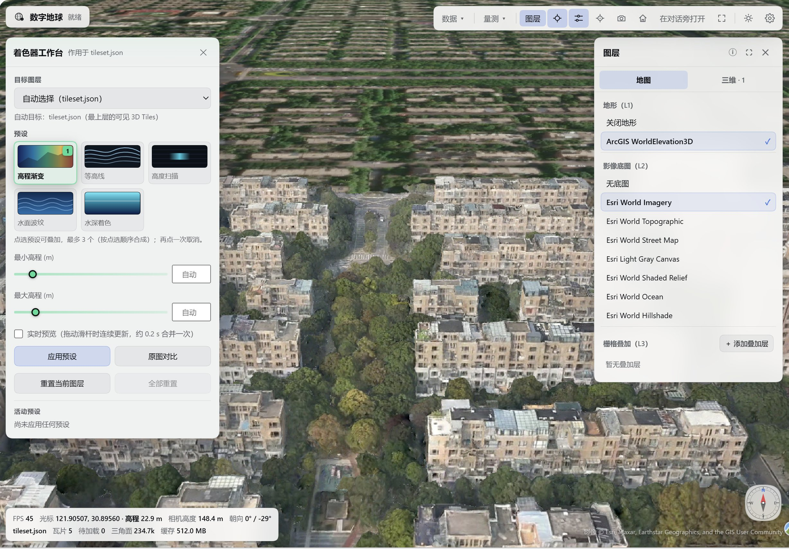
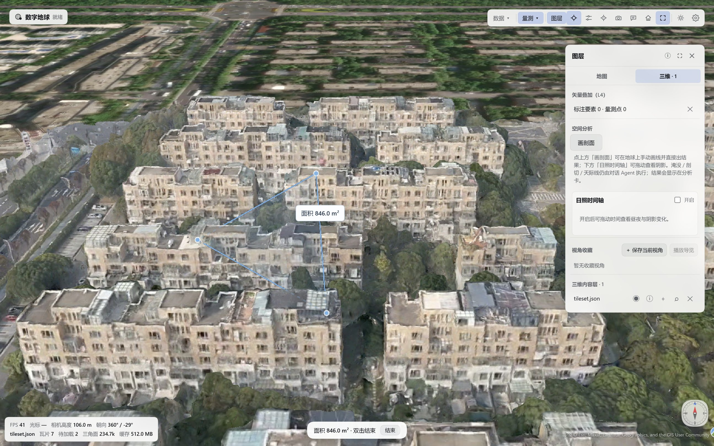
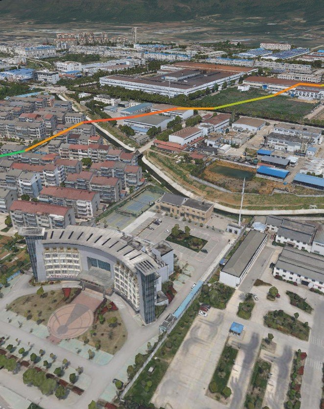

<div align="center">


# Digital Earth

**3D Tiles and 3DGS on a CesiumJS globe, with the scene readable and drivable by the Agent in the chat.**

[中文](README.md) · [English](README.en.md) · [Issues](https://github.com/CVEO/dsh-digital-earth/issues) · [Changelog](CHANGELOG.md)


</div>



Digital Earth is a DeepSeek Harness (DSH) plugin that puts a CesiumJS globe in the workspace, next to the conversation. It lets people browse photogrammetry and Gaussian-splatting deliverables, and it lets the Agent read, drive, measure and analyze that scene in natural language. CesiumJS 1.147 and the UI assets ship with the plugin — no Cesium ion token, no external static assets. Imagery basemaps, terrain and online tiles still reach the services you select.

## Demo

These are real panel captures. The sample data is a project-owned LOD18 photogrammetry scene; the images contain no local paths. The hero is the overview; the rest shows one capability each.

**Annotate / measure: draw an extent or measure a distance on the globe, or have the Agent annotate from GeoJSON; coordinates, areas and results stay in the panel.**



**Profile: in the 3D tab click "Draw profile" and the start / end points on the globe; the card reports relief, slope, cut/fill and the profile line.**



**Shaders: five white-listed presets per 3D Tiles layer, such as water and elevation; the workbench stacks 1–3 presets, tunes sliders and compares against the original look.**


## Features

**Data and scene**

- 3D Tiles 1.0 / 1.1 (b3dm, glb) and 3DGS (`KHR_gaussian_splatting`, SPZ included); multiple layers with show / hide, fly-to and remove.
- Three ways in: recursively scan a local folder for `tileset.json`, paste an `http(s)` URL, or pass an absolute local path. A path outside the chosen folders triggers one authorisation prompt; a denial is not retried.
- Four layer groups: L1 terrain, L2 imagery basemap, L3 raster overlays (WMS / XYZ / ArcGIS), L4 vector overlays.
- Data health check: asset version, root geometric error, LOD depth, tile / content counts, external tilesets, `extensionsUsed`, missing content and bounding-volume problems; the report is written to disk.
- Six built-in tools: `earth_scene`, `earth_capture`, `earth_draw`, `earth_measure`, `earth_analyze`, `earth_shader`; every call gets a tool row in the conversation.

**Measure and annotate**

- Distance, area, height and 3D Tiles property picking; left click to add a point, double click to finish, **Esc** or the on-chip "End" button to leave.
- The Agent can draw points, lines, polygons and labels from GeoJSON; drawn and measured results stay until `clear=true` or a menu clear.

**Terrain analysis (panel + conversation)**

- Terrain analysis: profile, flood, sunlight, clip and skyline; one active result at a time, shown as a scene overlay plus an analysis card.
- Draw a profile in the 3D tab (start / end clicks) or scrub the sun timeline; flood / clip / skyline go through `earth_analyze` in the conversation.
- Profile results include cut / fill / net volumes and mean / max slope; the design baseline and width are configurable, and one click exports CSV / SVG.
- Sun timeline: drag the date / time to see solar altitude and shadows; a scene-wide night filter dims photogrammetry and terrain together.

**Shader presets**

- Five white-listed presets: elevation ramp, contour, scan, water and water-depth. One shader per layer, and `preset` also accepts an ordered array of 1–3 presets to stack.
- The workbench offers preset thumbnails, a target-layer hint, reorderable stacking, parameter sliders, live preview and an original-look comparison. 3DGS layers are for browsing; shaders are white-listed presets.

**Identify and evidence**

- Neutral hit levels (3D tile region / feature inside a tile / scene surface) instead of invented object names or fake precision.
- Red / amber / green confidence chips mark the source of every claim; surface elevation is sampled, height is a geometric estimate from 24 neighbourhood points, and unknowns plus limits go into the evidence JSON.

**Tour and hand-off**

- View bookmarks and a guided tour: each stop is one camera view plus one caption, with distance-adaptive flights; dragging the globe or clicking elsewhere takes over immediately.
- Clean snapshots: manual and Agent snapshots keep only the 3D view by default (following the panel setting, which is off out of the box); pass `include_hud=true` per call or enable the setting to burn in the HUD.
- `earth_scene` reports: self-contained HTML (screenshot embedded) or Markdown, written under `$DSH_HOME/digital-earth/exports`.
- `/earth` slash commands, Ask Agent context injection and per-session scene restore; switching sessions or restarting DSH still brings back the camera, layers and annotations.

**Interface**

- Collapsible panels, a bilingual UI (follows the DSH language, switches live) and light / dark themes.
- Two layer-panel tabs: **Map** (terrain / imagery / raster) and **3D** (vector / 3D content / spatial analysis / sun / view bookmarks / shader).
- Compass: bottom-right, rotates with the camera; click to face north.
- The coordinate HUD samples at about 5–6 Hz; FPS comes from real Cesium render passes and shows `—` after two idle seconds instead of a fake 0.
- Two render-quality tiers (Balanced / High); the active tier and effective resolution are reported in `earth_scene status` → `render`.

## Quickstart

**Requirements**

- DeepSeek Harness `>=0.2.1-rc.1 <0.3.0-0` (same range as `engines.dsh` in `package.json`).
- A modern browser with WebGL / WebGL2; the panel is part of the DSH Web UI.
- Online basemaps, terrain and tiles need to reach the selected public services (for example `server.arcgisonline.com`, `elevation3d.arcgis.com`); offline, use local tiles or turn the basemap off.
- Node.js 22 or 24 is needed only for development and builds (CI covers both); there are no runtime dependencies.

**Install**

```bash
# from the npm registry
dsh plugin --profile <profile> add @cveo/dsh-digital-earth

# or from a local tarball (run in the repository root)
dsh plugin --profile <profile> add ./cveo-dsh-digital-earth-1.5.1.tgz
```

You can also search for "Digital Earth" in the plugin market. After installing or updating, **fully quit and reopen DSH**: client bundles are registered when the host starts, so reloading the page is not enough. The globe button then appears in the chat header and a Digital Earth entry appears in the sidebar.

**Load your first dataset**

1. Click the globe button in the chat header (or just ask the Agent to call an earth tool — the panel opens by itself and waits for the connection).
2. Use **Data ▾ → Open local folder…** and pick a folder containing `tileset.json`, or **Data ▾ → Load address or coordinates…** and paste an `http(s)` URL / absolute local path, or enter `lon,lat[,height]` (for example `113.14,31.02,900`) to fly there.
3. If the folder is not whitelisted, the panel asks once for authorisation; allow it to continue. A denial is not retried.
4. Drag to explore, measure a distance with the Measure menu, or tell the Agent: "run a data health check on the current layer".

Five-minute check: you can see the globe, load one tileset, measure a distance and ask the Agent for a snapshot. Use your own standard 3D Tiles. A sample prompt can be: `Load D:\data\city\tileset.json, fly to the city centre and take a snapshot` (replace the path with yours).

## Using the panel

| Entry | What it does |
| --- | --- |
| Globe button | Opens the Digital Earth tab beside the conversation; the panel toolbar has the only real fullscreen entry (DOM Fullscreen, Esc exits) |
| Data ▾ | Open a local folder, re-scan a recent one, load an address or coordinates, clear Agent annotations and measurements, export a scene report |
| Measure ▾ | Distance / area / height / property picking; left click to add a point, double click to finish, Esc or "End" on the chip to leave |
| Draw profile | In the 3D tab click "Draw profile", then click the start / end point on the globe; the result opens in the analysis card |
| Sun timeline | In the 3D tab enable it, then drag the date / time to watch day/night tone and terrain shadow changes |
| Identify | Click an object to open the selection card (coordinates, surface elevation, geometric height estimate, confidence) with approach / measure / export evidence |
| Layers | Two tabs: Map (terrain / imagery / raster / view bookmarks) and 3D (vector / 3D content / spatial analysis / sun); the header ⓘ opens the separate "Scene details" card |
| Shader | Opens the workbench: choose a 3D Tiles layer and a preset, tune parameters, apply / reset / compare with the original |
| Ask Agent | Adds the current view and a concise scene summary to the current conversation context, then lets you type the question directly; it applies on the next step and does not start an idle conversation |
| Settings | Data sources (imagery / terrain), appearance, render quality, Detailed HUD, snapshot annotation and an About tab |

**Loading and layers**

- Local folders are remembered in `$DSH_HOME/digital-earth/directories.json`, so they stay loadable after a DSH restart.
- The scene is saved per session: camera, layers and visibility, Agent annotations / measurements, the active analysis and shader presets per layer. The snapshot lives on the host; localStorage is only a cache and fallback.
- The layer card opens even with no 3D Tiles loaded, so terrain / basemap / raster overlays remain reachable.

**Measure and identify**

- Press **Esc** or click "End" on the chip to leave a measurement; double-click finishes and keeps the result, and clicking the same tool again resumes.
- The identify card marks each claim with a high / medium / low confidence chip, and the evidence JSON tags every number as measured / estimated / inferred; the evidence pack is a clean PNG plus a JSON under `$DSH_HOME/digital-earth/exports/`.
- The evidence JSON records position, sampling method, camera, time and uncertainties. Without a batch table it writes a neutral hit level and never invents a name.

**Analysis: panel + conversation**

- Profile: in the 3D tab click "Draw profile", then click the start / end point on the globe to get a result; sun: in the 3D tab enable the timeline and drag the date / time.
- Flood / clip / skyline still go through the Agent: `Run a flood analysis on the current layer at 75 m` (replace the values).
- One analysis at a time; a new one replaces the previous one. The "Spatial analysis" section shows the active summary and ✕ clears it and its overlay.
- Without valid elevation data it returns an actionable error instead of estimated numbers.
- The profile card switches the design baseline (start–end grade / lowest-point level) and road width, updates cut/fill live, and shows a thumbnail chart; click it to open the full chart and export CSV / SVG from there.
- Sun: at night a scene-wide dimming filter darkens photogrammetry and terrain together; daylight restores the original brightness.

**Shader workbench**

- Pick a layer and presets, tune parameters and stack up to three presets. Live preview applies silently while dragging; an explicit Apply writes to the scene.
- Applied effects hang off the 3D Tiles layer row: hover for parameters, click the row (or ✦) to load it into the workbench.
- 3DGS layers are for browsing; shaders are white-listed presets.

**Tour and hand-off**

- "View bookmarks" saves the current camera (up to 20). With two or more stops you can "Play tour", and each stop can carry one caption.
- Snapshots are clean by default; the report and snapshot paths come back from the tools and can be shown with `present`. The capture folder keeps the latest 50 images.

**Data sources**

| Kind | Built-in presets |
| --- | --- |
| Imagery | Esri World Imagery, World Topographic, World Street Map, Light Gray Canvas, World Shaded Relief, World Ocean, World Hillshade |
| Terrain | ArcGIS WorldElevation3D |

Custom sources support XYZ tiles (TMS, projection, subdomains, maximum level, attribution), WMS, ArcGIS MapServer, Cesium terrain services and local tile folders; selections persist to `$DSH_HOME/digital-earth/sources.json`.

## Agent tools

The host registers six tools whose names and parameters are a stable contract. Tool results report state and paths; they never fabricate picture content. Analysis has no panel button by design — call `earth_analyze` from the conversation.

| Tool | Key parameters | What it does |
| --- | --- | --- |
| `earth_scene` | `action` (`status` / `list` / `load` / `remove` / `visible` / `basemap` / `terrain` / `fly` / `reset` / `pick` / `inspect` / `report`); `layer` / `path` / `url` / `visible` / `imagery` / `terrain` / `lon` / `lat` / `height` / `heading` / `pitch` / `duration` / `deep` / `format` / `title` / `include_capture` | Read and drive the scene and layers; `fly` defaults to 1500 m height and -45° pitch; `inspect` runs a health check; `report` exports a scene report |
| `earth_capture` | `width` (480–2560, default 1280), `format` (`jpeg` / `png`), `include_hud`, `label` | Captures a snapshot and returns its absolute host path; `include_hud=true` burns the HUD and credits into the image |
| `earth_draw` | `features` (GeoJSON string), `style` (`accent` / `alert` / `success` / `warm` / `violet`), `label` (≤80 chars), `clear` | Draws points / lines / polygons and text labels; up to 500 features / 20000 coordinates per call; `clear=true` removes earlier Agent overlays |
| `earth_measure` | `mode` (`distance` / `area` / `height`), `points` (`[lon,lat]` or `[lon,lat,height]`, up to 200, at least 2), `draw`, `clear` | Geodesic distance, planar area (perimeter included) or height difference (with horizontal distance and slope) |
| `earth_analyze` | `action` (`profile` / `flood` / `sunlight` / `clip` / `skyline` / `clear`), `layer`, `from` / `to`, `samples` (8–64, default 32), `region` (span ≤10°), `water_height`, `grid` (4–24, default 12), `datetime` (1900–2200), `show_shadows`, `height` (-1000–9000), `keep` (`below` / `above`) | Terrain analysis; one active analysis at a time; returns an error rather than guessing when elevation data is missing |
| `earth_shader` | `action` (`apply` / `reset` / `list`), `layer`, `preset` (one of five, or an array of 1–3), `min_height` / `max_height`, `interval` (1–500), `speed`, `amplitude`, `opacity`, `water_height`, `depth_max` | White-listed shader presets (for ordinary 3D Tiles) |

**Two example prompts**

> Load `D:\data\city\tileset.json`, switch to satellite imagery, fly to the scene centre and take a snapshot.

> Run a data health check on the current layer and list any missing content; then measure the height difference from the view centre to a point 300 m north-east.

**Error convention**

- Tool errors start with `[code]` and include one `next:` step. Follow it rather than repeating the same failing call.
- Local paths outside the whitelist return `access_denied` or `access_timeout`; neither is retried automatically — the user must re-authorise in the panel.
- Missing elevation, 3DGS with shaders, and capturing while the panel is hidden all return actionable errors instead of empty results.

| `/earth` command | What it does |
| --- | --- |
| `/earth status` | One-screen summary of camera, layers, basemap / terrain and Agent overlay counts |
| `/earth capture [label]` | Captures a snapshot and returns its absolute host path, with an optional label |
| `/earth report [html\|markdown]` | Exports a scene report and returns its absolute host path; HTML by default |
| `/earth clear` | Clears Agent-drawn annotations and measurements |
| `/earth open` | Guidance: the next earth tool call opens the tab, or use the globe button in the chat header |
| `/earth` | Shows usage |

Command results stay in the command bubble and never enter the model context; when the panel is not connected, the command returns a command error instead of a model message.

## Data & security

**Standard 3D Tiles contract**

- Only standard 3D Tiles 1.0 / 1.1 are accepted: the root tile must carry a world placement (`root.transform` or `root.boundingVolume.region`).
- The plugin never rewrites data implicitly: the bytes Cesium receives always equal the bytes on disk. A nested external tileset is placed by its parent root transform and is not transformed twice.

**Diagnosing a missing world placement**

- Symptoms: the dataset collapses near the Earth's centre, `flyTo` dives toward the core, and tiles flicker in and out of the frustum. This is not a render bug.
- The health check reports `tileset_not_georeferenced` with the fix: write a root `transform` / `region` at export time.
- Existing OSGB conversions can be repaired once with `scripts/georef-osgb.mjs`: dry-run by default, `--apply` keeps a `tileset.json.bak`, and CGCS2000 Gauss-Krüger EPSG 4491–4554 is supported. The runtime still never reads sidecars and never rewrites data.

**Local data**

- Only folders opened through the panel (or authorised once by the user) are served by `/tiles`; the whitelist, real-path and root checks live on the host.
- The Agent may pass an absolute local path; outside the whitelist the host asks the panel for a one-time authorisation, and an unanswered request returns `access_timeout` after 30 seconds.
- The plugin never uploads data and never reaches out on its own; network requests only go to the imagery, terrain and online tile services you select.

**Access control and proxy**

- Every route is bound to the DSH `connection` session, same-origin checks and a plugin-instance token; the token is only handed to the page and never appears in tool results.
- The `/remote` proxy rejects literal loopback / private addresses and 3xx redirects, and forwards query strings (up to 2048 characters; overlong gets 400, control characters or invalid encoding get 403).
- The proxy does not resolve DNS: a hostname that resolves to an internal address can still slip through — see FAQ.

**Output and retention**

- Snapshots under `$DSH_HOME/digital-earth/captures` keep the latest 50 images; health reports keep the latest 100.
- Scene reports and evidence packs share the latest 200 files under `$DSH_HOME/digital-earth/exports`.
- One scene snapshot per session, written atomically, capped at about 512 KB, keeping the latest 50 sessions.

## How it works

The host owns data and services; the client owns the Cesium frame and the panel. The two sides talk over a token-protected SSE command bridge. `client.js` is the build output of `src/client/**` — do not edit it by hand.

<pre>
Host (Node)                                   Browser (DSH Web UI)
+------------------------------+   commands   +---------------------------+
| index.js   inject / apply    | -----------> | src/client/**  -> client.js|
| src/host/tools/* (6 tools)   |              | CesiumJS + panel          |
| routes / bridge / storage    | <----------- | (vendor/cesium, bundled)  |
+------------------------------+   acks/data  +---------------------------+
</pre>

- **Host**: `index.js` only does `inject` / `apply` plus public re-exports; the implementation lives in 28 modules under `src/host/**` (routes, command bridge, health checks, storage, six tools, `/earth`).
- **Client**: 53 modules under `src/client/**` are bundled by esbuild into one `window.__ModuleLoader__` artifact; it dynamically `import()`s the self-hosted CesiumJS and registers the sidebar tab and tool rows.
- **CesiumJS**: `vendor/cesium` ships with the plugin — no CDN, no Cesium ion token.
- **Release**: tag-only with GitHub Actions OIDC. The local `npm run release:check` is a read-only dry run over version single-sourcing, artifact consistency and package contents; it never tags, pushes or publishes.

## FAQ

- **Which data works?** Standard 3D Tiles 1.0 / 1.1 (b3dm, glb) and 3DGS (SPZ); load from a local folder, a URL or an absolute local path.
- **What can 3DGS do?** Browse, fly to, show / hide and remove; analysis and shaders target ordinary 3D Tiles.
- **Why is the HUD missing from my snapshot?** Manual and Agent snapshots keep only the 3D view by default; pass `include_hud=true` per call or enable the snapshot setting.
- **Black screen or model near the Earth's centre?** Run the health check and confirm the root tile has a `transform` or `region`; re-export with world placement and reload.
- **Is my data uploaded?** No; the plugin reads local files and the online sources you choose.
- **Where is the analysis button?** Profile and sun are in the 3D tab (draw profile + sun timeline); flood / clip / skyline use `earth_analyze` in the conversation.
- **Where are snapshots and reports saved?** The snapshot folder keeps the latest 50 images, reports 100, exports 200; the tool returns the exact path.
- **How fast is it?** It depends on the GPU, window size and data; try it with your own data.

## Roadmap

These are directions under discussion, not version commitments; scheduling follows the issues.

- **Data security**: a post-DNS-resolution check in the `/remote` proxy to tighten the untrusted-network boundary.
- **Large-dataset experience**: loading and dragging larger tilesets, plus continued cache and quality-tier tuning.
- **Hand-off formats**: more export shapes for analysis results and automation around reports / evidence packs.
- **Docs and examples**: fuller integration examples, common data-conversion flows and a troubleshooting guide.

## Contributing

Issues and suggestions are welcome in the [issue tracker](https://github.com/CVEO/dsh-digital-earth/issues); development, build, test and release steps are in [CONTRIBUTING.md](CONTRIBUTING.md). Keep the six tools' names, parameters and action sets unchanged; prefer panel-side work or new optional parameters for new capabilities.

## Credits & license

**Credits**

- CesiumJS 1.147, distributed under Apache-2.0 and self-hosted with the plugin; see [NOTICE](NOTICE) for third-party attribution.
- DeepSeek Harness for the plugin runtime, command bridge and tool-call UI.
- Sample data: a project-owned LOD18 photogrammetry scene; the 3DGS sample Svirnas Alyt comes from WilliamLiu's 3D-Tiles-RendererJS-3DGS-Plugin (Apache-2.0).
- Imagery and terrain come from public ArcGIS services accessed at runtime and remain subject to their providers' terms.

**Team and license**

Maintained by the **CVEO Research Group, Wuhan University** · <https://www.whu-cveo.com/>

Released under the MIT license; see [LICENSE](LICENSE) and [NOTICE](NOTICE).
