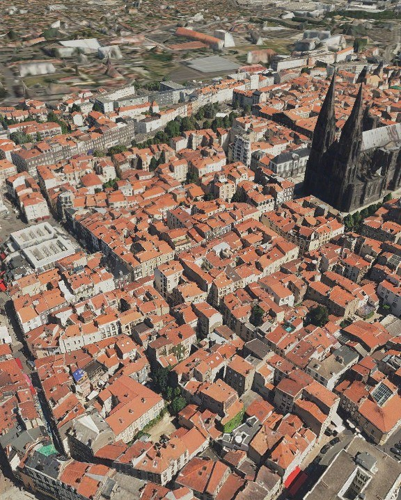
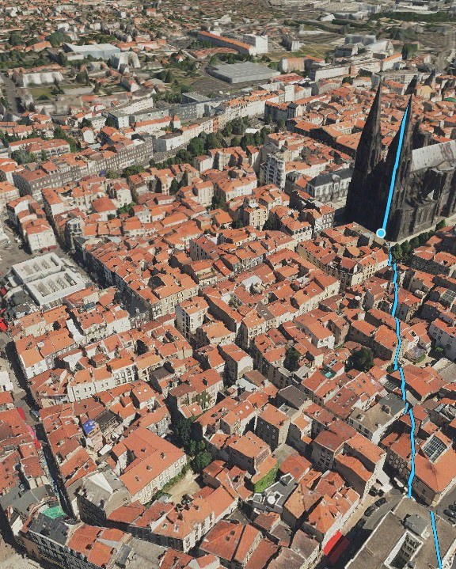
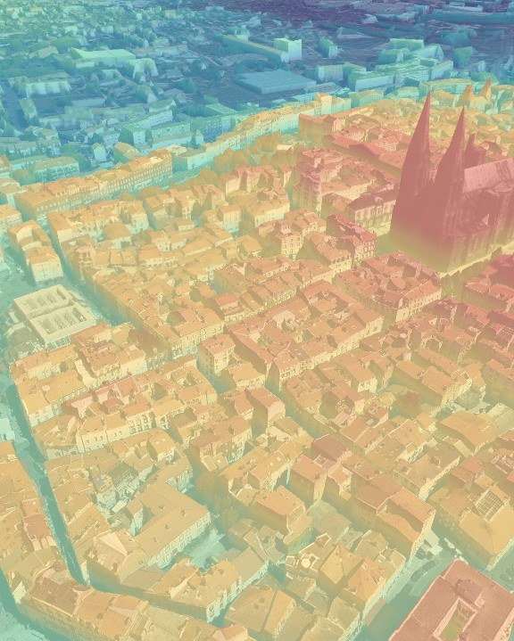
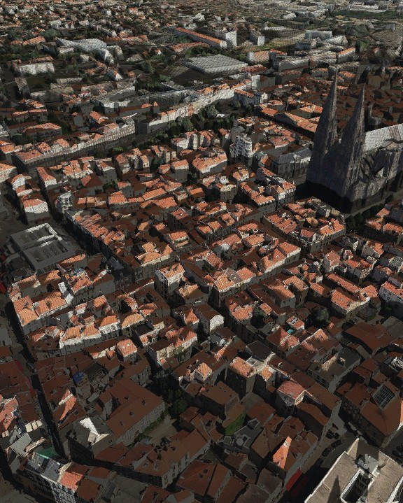
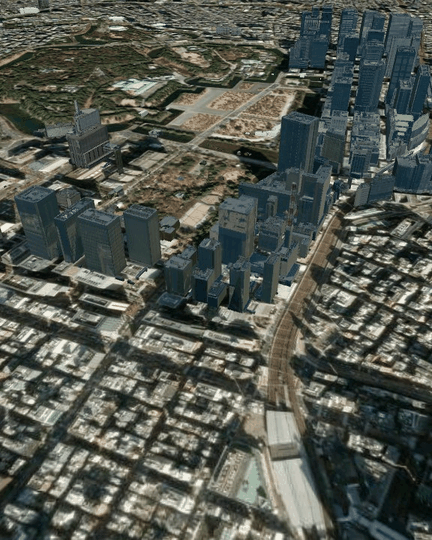

<div align="center">


# Digital Earth · 数字地球

**Digital Earth is a 3D scene plugin for DeepSeek Harness: it loads, browses, measures and analyses 3D Tiles / 3DGS data, and lets the Agent read and write the current scene.**

Built by the CVEO Research Group, Wuhan University — a 3D component for 3D cities, reality capture and multimodal Earth-observation data

[中文](README.md) · [English](README.en.md) · [Changelog](CHANGELOG.md) · [License](LICENSE)




</div>

After opening Digital Earth in DSH, the 3D scene panel appears beside the conversation. Load local or online 3D Tiles / 3DGS data, then browse, measure and run terrain analysis while continuing the conversation; the Agent can also read and write the scene, add annotations, capture images and export reports.

The 3D engine and UI assets ship with the plugin, so no additional GIS server is required; user data stays on the local machine, while online imagery and terrain are accessed through the selected sources.

## Quick start

Search for "Digital Earth" in the plugin market, or install from npm / a local tgz:

```bash
# npm
dsh plugin --profile <profile> add @cveo/dsh-digital-earth

# local tarball
dsh plugin --profile <profile> add ./cveo-dsh-digital-earth-1.5.1.tgz
```

1. Quit DSH completely and start it again (the client bundle registers at startup; a page refresh is not enough).
2. Click the globe button in the chat header to open the Digital Earth tab on the right.
3. Data ▾ → open a local folder that contains a `tileset.json`, or paste an online URL / enter coordinates to fly there.

After loading data, send the Agent a direct instruction:

> Load the tileset.json in the folder I just opened, fly to the centre, measure the distance between two buildings, and take a snapshot.

When an unauthorised folder is accessed for the first time, the panel requests authorisation once; after approval the folder loads directly.

## Core capabilities

- **Scene browsing**: stack multiple 3D Tiles / 3DGS layers with visibility, fly-to and attribute identification; the layer list has Map / 3D tabs, Collapsible panels and a compass that resets north.
- **Measurement and identification**: distance, area and height difference, with results and annotations kept in the panel; the coordinate HUD samples at 5–6 Hz and the identify card reports surface height and an estimated geometric height.
- **Terrain analysis**: profile, flood, sunlight, clip and skyline — one active analysis at a time, drawn in the scene with the height source (3D surface or terrain) stated in the result.
- **Deliverables**: Clean snapshots (Manual and Agent snapshots keep only the 3D view by default), HTML / Markdown scene reports, evidence packs and per-session scene restore; the snapshot folder keeps the last 50 files, suitable for reports, presentations and archives.
- **Agent integration**: Six built-in tools (`earth_scene`, `earth_capture`, `earth_draw`, `earth_measure`, `earth_analyze`, `earth_shader`) let the conversation read and write the scene; Shader presets are white-listed, with 1–3 presets composed and compared against the original view.
- **Data access**: recursive local folder scan, absolute local path and `http(s)` URLs; a local path is authorised once and never read outside the granted folders.

## Interface and interaction

All screenshots below are from real panel sessions. Sample data: the public Clermont-Ferrand 3D Tiles dataset (France), ready to load: <a href="https://3d.craig.fr/datasets/Clermont/3dtiles/tileset.json">3d.craig.fr/datasets/Clermont/3dtiles/tileset.json</a>.

<div align="center">





<p align="center"></p>

</div>

**Example conversation** (a real run; the tool calls below come from the same session):

> **You**: Load the Clermont-Ferrand 3D Tiles, measure the distance from the cathedral to Place de Jaude, and take a snapshot.
>
> **Agent**: `earth_scene load` → `earth_measure distance` → `earth_capture`
>
> **Result**: 381.12 m; the snapshot is saved in the snapshot folder and the measurement stays on the globe.

**Measure and annotate**: measure distance, area and height on the globe, or let the Agent draw points, lines and polygons from GeoJSON; results stay in the panel and can be captured at any time.

**Profile**: choose Draw profile in the 3D tab, click the start and end points, and the analysis card reports relief, slope, cut/fill and the profile line.

**Shaders**: five white-listed presets — height false-colour, contour, scan, water and water-depth — applied per layer; the workbench supports composition, parameter sliders and comparison with the original view.

## Data and accuracy

- **3D Tiles**: standard 1.0 / 1.1 (b3dm, glb); the root tile must carry a world placement (`root.transform` or `root.boundingVolume.region`). If an OSGB-converted dataset lacks that transform, run the `georef-osgb` script once in the repository (the npm package does not include the script).
- **3DGS**: `KHR_gaussian_splatting` (including SPZ compression). The panel reads content headers to tell mesh from 3DGS. Splats are great for browsing, identification and annotations, but they do not provide a sampleable surface height: profile / flood / skyline need terrain or a mesh 3D Tiles layer.
- **Basemaps and terrain**: built-in Esri imagery, ArcGIS terrain and other common services, or your own XYZ / ArcGIS / WMS sources; turn the basemap off when offline.
- **Heights and areas**: heights come from the 3D surface or online terrain and are ellipsoidal; areas are a local planar approximation. For accuracy-critical work, use the results of your professional software and tell us the convention you need.
- **Large datasets**: reality-capture models of hundreds of MB and tilesets with thousands of tiles load directly; the snapshot and report folders keep the most recent files automatically.

Public sample data: <a href="https://3d.craig.fr/datasets/Clermont/3dtiles/tileset.json">Clermont-Ferrand 3D Tiles</a> (France, published by CRAIG) — paste the address into the panel to open it.

## Agent tools

Six tools are registered by the Host; their names and parameters are a stable contract, and the panel and the conversation share the same operations:

| Tool | Purpose |
| --- | --- |
| `earth_scene` | Read or change camera, layers, basemap, terrain and visibility; `load` / `remove` / `visible` / `fly` / `reset` / `pick` / `inspect` / `report` |
| `earth_capture` | Save a snapshot and return its host path; optional JPEG / PNG, size and HUD |
| `earth_draw` | Draw points, lines, polygons and labels from GeoJSON; clear previous Agent overlays |
| `earth_measure` | Measure geodesic distance, polygon area and height difference, with values and labels |
| `earth_analyze` | Terrain analysis: `profile` / `flood` / `sunlight` / `clip` / `skyline` / `clear`; one height source (3D surface or terrain) per run |
| `earth_shader` | Apply / reset / list white-listed shader presets; 1–3 presets can be composed |

Besides the tools, `/earth` commands in the conversation can read status, capture, write a report or clear annotations.

## Citation and papers

Digital Earth is part of the CVEO Research Group's long-term research. If it helps your research, teaching or project, a citation is welcome — these two papers are the most relevant to 3D city modelling and reconstruction:

[1] CHENG J X, HUANG X R, CHEN G Z, et al. FACTS: training-free zero-shot diffusion framework for facade texture restoration in 3D urban models[J]. Advanced Engineering Informatics, 2026, 71: 104385. DOI: 10.1016/j.aei.2026.104385.

[2] WANG J Q, CHEN G Z, ZHANG X D, et al. Utilizing geometric primitives for depicting planar building roof structure from high-resolution remote sensing imagery[J]. International Journal of Applied Earth Observation and Geoinformation, 2025, 141: 104630. DOI: 10.1016/j.jag.2025.104630.

More publications: <a href="https://www.whu-cveo.com/research/">whu-cveo.com/research</a>.

## Team and business collaboration

**Official channels**: npm (`@cveo/dsh-digital-earth`), the DSH plugin market (publisher CVEO) and the group website <a href="https://www.whu-cveo.com/">whu-cveo.com</a>. For questions, data-compatibility reports or feature requests, contact us through the group website.

The plugin is released under MIT and is free to use commercially. The group also offers team-oriented services:

- **Private deployment**: on-premises / private-cloud deployment, offline tiles and terrain, upgrades and maintenance.
- **Team access control**: multi-user and role permissions, project and data isolation, audit logs, single sign-on.
- **Multimodal Earth-observation intelligence**: perception, understanding and analysis for SAR, multispectral, hyperspectral and point-cloud data — not just 8-bit RGB. General-purpose LLMs usually only handle 8-bit RGB imagery; these data need dedicated pipelines and models, which is one of our long-term research directions.
- **Jingwei Guanshu spatio-temporal agents**: industry collaborations, custom development and integration, training and technical support.

Contact: collaboration page <a href="https://www.whu-cveo.com/collaboration/">whu-cveo.com/collaboration</a> · WeChat official accounts "CVEO课题组" and "珞珈经纬".

### License and credits

Released under MIT; see [LICENSE](LICENSE) for the full text and [NOTICE](NOTICE) for third-party licences. CesiumJS is distributed under Apache-2.0 and self-hosted with the plugin; imagery and terrain use ArcGIS public services at runtime and remain the property of their providers; the loading animation uses the public-domain Natural Earth II data shipped with CesiumJS. The screenshots use the publicly released Clermont-Ferrand 3D Tiles dataset published by CRAIG.

Maintained by the **CVEO Research Group, Wuhan University** · <a href="https://www.whu-cveo.com/">www.whu-cveo.com</a>
