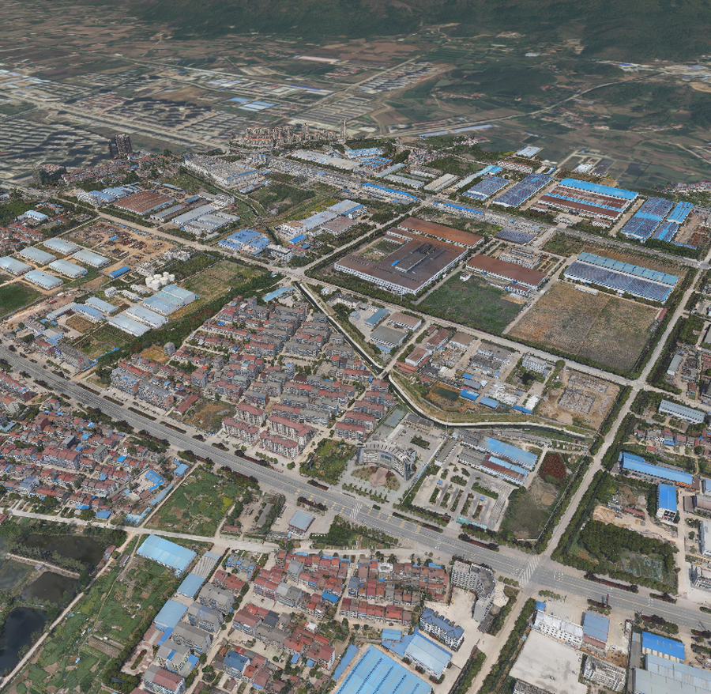

<div align="center">

# 数字地球 · Digital Earth

**在 CesiumJS 地球上叠加 3D Tiles / 3DGS 图层的 DeepSeek Harness 面板**

[中文](README.md) · [English](README.en.md)

[](https://github.com/CVEO/dsh-digital-earth/actions/workflows/ci.yml)
[](https://github.com/CVEO/dsh-digital-earth/actions/workflows/publish.yml)


**仓库 / Repository:** <https://github.com/CVEO/dsh-digital-earth>

</div>



数字地球是一个 DSH 插件：把 CesiumJS 三维地球嵌入主工作区，用统一的面板浏览实景三维与高斯泼溅成果。自托管 CesiumJS 1.147，不依赖 Cesium ion Token，不请求外网静态资源。

## 功能

| 能力 | 说明 |
| --- | --- |
| 实景三维叠加 | 本地目录递归扫描 `tileset.json`；3D Tiles 1.0 / 1.1（b3dm、glb）与 3DGS（`KHR_gaussian_splatting`，含 SPZ 压缩）；多图层同时叠加、显隐 / 定位 / 移除 |
| 在线与本地路径 | 直接粘贴 `http(s)` 地址或本机绝对路径；跨域失败自动回退到宿主代理 |
| 影像底图 | 内置多个 Esri 底图预设，可自定义 XYZ（TMS、投影、子域名、最大层级）/ WMS / ArcGIS 服务；无底图模式也完整可用 |
| 地形 | 内置 ArcGIS WorldElevation3D，可接入任意 Cesium / ArcGIS 地形服务 |
| 本地瓦片 | 直接把本地 XYZ / TMS 瓦片目录添加为底图，离线可用 |
| 数据源管理 | 设置面板内增删改、单选启用、恢复默认，配置持久化到 `$DSH_HOME/digital-earth/sources.json` |
| 坐标 HUD | 光标经纬度 + 高程；裸地球、地形、模型三种情形均可用，约 8 Hz 采样，不触发重渲染 |
| 量测与工具 | 测距、测面、测高、拾取 3D Tiles 属性、PNG 截图、复位视角 |
| 图层统计 | 每层瓦片数、待加载数、三角面数、缓存占用；全局 FPS 与相机高度 / 朝向 |
| 双语 | 跟随 DSH 语言，中文 / English 运行时即时切换 |
| 主题 | 跟随 DSH 或系统；可显式选择浅色 / 深色，仅作用于本面板 |
| Agent 工具（v1.1.0） | 对话中操作地球（`earth_scene`）与截图（`earth_capture`）；设置新增「关于」页与 GitHub 链接，详见下文 |

### Agent 能力（v1.1.0）

版本 **1.1.0** 起，对话里的模型可以直接操作、观察数字地球：

- **`earth_scene`**：操作已打开的数字地球面板——`status`（读取相机 / 图层 / 底图 / 地形快照）、`load` / `remove` / `visible`（加载、删除、显隐 3D Tiles / 3DGS 图层）、`basemap` / `terrain`（切换底图与地形）、`fly` / `reset`（飞行与复位相机）、`pick`（按经纬度拾取要素属性）。
- **`earth_capture`**：把当前视口截成 PNG 存到工作区，返回路径、相机与图层摘要；模型随后用 `read_image` 读取截图再描述画面。截图只含 Cesium 画布，天然不含 HUD / 工具栏。
- **设置 →「关于」页**：显示版本号、项目仓库、课题组、许可证与 CesiumJS 署名，页脚新增 GitHub 链接。

> v1.1.0 **不含**右栏停靠 Tab、Agent 标注（`earth_draw`）与 Agent 量测（`earth_measure`）工具——它们仍在 roadmap 中，请勿据此假设已可用。

## 环境要求

- DeepSeek Harness `>=0.2.1-rc.1 <0.3.0-0`
- 支持 WebGL / WebGL2 的现代浏览器
- 中国大陆网络可直接访问 ArcGIS 公共服务（`server.arcgisonline.com`、`elevation3d.arcgis.com`）

## 安装

在插件市场中搜索「数字地球」，或使用命令行：

```bash
# 从 npm 注册表安装
dsh plugin --profile <profile> add @cveo/dsh-digital-earth

# 从本地目录 / 打包文件安装
dsh plugin --profile <profile> add "<path-to-plugin>"
dsh plugin --profile <profile> add "./cveo-dsh-digital-earth-1.0.0.tgz"
```

安装或更新后请**完全退出并重新打开 DSH** 一次：客户端 bundle 在宿主启动时注册，仅刷新页面不会重新注册。随后左侧栏出现「数字地球 / Digital Earth」入口。

## 使用

| 入口 | 作用 |
| --- | --- |
| **数据 ▾** | 打开本地目录（递归扫描 `tileset.json`）、加载在线地址 / 本地路径、清除量测与拾取结果 |
| **底图 ▾ / 地形 ▾** | 在已配置的数据源之间切换，或关闭底图 / 地形 |
| **量测 ▾** | 测距、测面、测高、拾取属性；左键取点，双击结束 |
| **图层 n** | 图层面板：点名称定位、◉ 显隐、✕ 移除 |
| **外观** | 跟随系统 / 浅色 / 深色 |
| **设置** | 数据源管理（影像 / 地形）、外观设置；v1.1.0 起新增「关于」页与 GitHub 链接 |

鼠标坐标按约 8 Hz 采样：射线与椭球求交保证裸地球也有经纬度；命中 3D Tiles / 3DGS 时用深度缓冲取模型表面高程；有地形时用 `globe.getHeight` 校正。HUD 文本直接写入 DOM，不触发 React 重渲染。

## 数据源

内置预设均为免 Token 的 ArcGIS 公共服务，可在设置中一键启用：

| 类型 | 预设 |
| --- | --- |
| 影像 | Esri World Imagery、World Topographic、World Street Map、Light Gray Canvas、World Shaded Relief、World Ocean、World Hillshade |
| 地形 | ArcGIS WorldElevation3D |

自定义数据源支持：

- **XYZ 瓦片**：`{z}/{x}/{y}` 模板、TMS（Y 轴南起）、Web 墨卡托 / 地理坐标、子域名、最大层级、版权署名
- **WMS**：服务地址 + 图层名
- **ArcGIS**：MapServer 地址（自动读取层级信息）
- **Cesium 地形**：地形服务地址，可选请求法线 / 水面掩膜
- **本地瓦片目录**：在 XYZ 表单中直接选择目录，插件通过宿主白名单提供瓦片

选中的底图与地形随配置持久化，换端口或重开 DSH 都不会丢失。

## 工作原理

- **宿主侧**（`index.js`）：注册 `/api/3dviewer/*` 路由，负责 Cesium 静态资源、本地目录扫描与白名单、瓦片服务、跨域代理、数据源配置读写。
- **客户端**（`client.js`）：作为 DSH 客户端模块加载，声明 `sidebar.panellist` 与 `main` 槽位，按需动态 `import()` 自托管 CesiumJS。
- **安全**：所有路由绑定 DSH `connection` 会话与同源校验，并带一次性 token；`/tiles` 仅服务经文件选择器加入白名单的目录；`/remote` 代理拒绝 loopback / 私网地址，避免 SSRF。插件不上传数据、不主动外联。
- **自托管 CesiumJS**：`vendor/cesium` 随插件分发，无 CDN、无 Cesium ion Token。

## 已知限制

- `/remote` 代理不透传查询串，WMS / WMTS 需要服务端允许直连 CORS 才能使用；后续会补齐代理的查询串与重定向校验。
- 在线 Esri 服务在部分网络环境可能不可达，此时底图会显示为空白，可切换为本地瓦片数据源。

## 目录结构

```text
dsh-digital-earth/
├── index.js            # 宿主插件：路由、代理、本地资源、配置持久化
├── client.js           # 客户端面板：Cesium 场景、工具栏、数据源设置
├── cordis.patch.yml    # bundle 补丁
├── locale/             # 插件市场元数据（中 / 英）
├── vendor/cesium/      # 自托管 CesiumJS 1.147
├── test/               # node:test 结构测试（发布产物、工作流、Agent 桥）
├── .github/workflows/  # CI 与自动发布
├── icon.svg
└── preview.png
```

## 反馈与贡献

欢迎通过 [Issue](https://github.com/CVEO/dsh-digital-earth/issues) 报告问题或提出建议，也欢迎 PR。提交前请确保 `npm run check` 通过（语法检查 + `node --test`）。

## 团队

由 **武汉大学 CVEO 课题组** 维护 · <https://www.whu-cveo.com/>

## 许可

MIT。CesiumJS 以 Apache-2.0 分发，第三方声明见 [`NOTICE`](NOTICE)。
